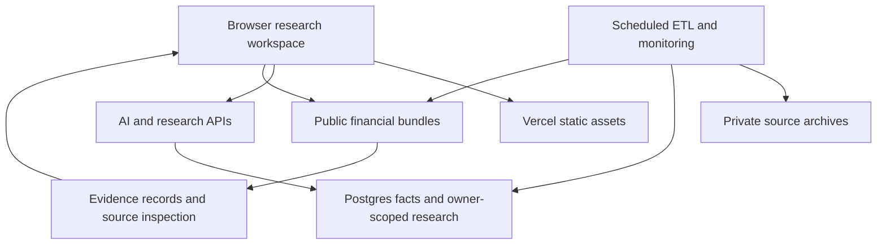

# Filed Under

Source-attributed research on US equities. Financial observations retain their SEC filing, period and accounting concept; calculated claims retain their formulas and original input records. Prices, macro series, filings, news and a research assistant sit around that core. Missing provenance and incomplete data remain visible.

Coverage today: the S&P 500 (S&P 100 flagged in the index).

## How it fits together



- **`etl/`** pulls and normalizes data and writes both Postgres rows and the JSON bundles the site reads.
  - `sec.py` submissions, XBRL company facts, statement series with filing attribution, per-filing statement tables, derived quarters.
  - `docs.py` original 10-K/10-Q statement tables with inline XBRL anchors, earnings release text (8-K EX-99.1).
  - `prices.py` daily and 5-minute bars, return/volatility/beta stats.
  - `statements.py` financial statements as filed from the SEC Financial Statement Data Sets (quarterly ZIPs: sub, pre, num, tag): every 10-K/10-Q of covered companies since 2009, keyed by accession, with filed line order, labels, tags, values, periods, axis/member segments and co-registrants. `stdmap.py` holds the standardized templates (industrial, bank, insurer, REIT, utility) and the documented tag mapping.
  - `fundamentals.py` TTM and latest-quarter metrics for screening.
  - `macro.py` Treasury par curve, FRED series (CPI, core CPI, unemployment, payrolls, fed funds, 2s10s), H.15 (feeds `macro.json` and the market brief).
  - Macro series store (`mstore.py`, jobs in `macrojobs.py`): official-source series with point-in-time vintages. Collectors: `frb.py` (Federal Reserve Board release files: H.15, H.4.1, H.8, H.6, G.17, G.19, SLOOS, SCOOS, debt service ratios, Z.1), `nyfed.py` (NY Fed Markets API: reference rates, repo and reverse repo operations, SOMA, primary dealers), `treasury.py` (par curve, bills, real yields), `bls.py` (BLS API v2: CPI components, payrolls by sector, household survey, JOLTS, ECI), `oecd.py` (OECD SDMX: CLI, confidence, CPI, GDP, unemployment, short and long rates for G20 and aggregates), `cftc.py` (Commitments of Traders), `fdic.py` (BankFind aggregates and failures), `mcal.py` (release calendar from the Fed, BLS and CFTC schedules).
  - `insiders.py` Form 4 XML parsing (owner, role, code, shares, price, holdings after, 10b5-1).
  - `news.py`, `summaries.py` recent coverage and written summaries.
  - `screener.py` the screener factor table: 189 fields per company (valuation and 5-year percentiles, growth, quality, balance sheet, Piotroski components, technicals, correlations to market, rates, commodities, the dollar, bitcoin and macro series, insider and filing activity, KPI families, segments), each with a definition, unit, source and per-company provenance.
  - `kpi_taxonomy.py`, `kpistd.py` standardized KPIs: a canonical taxonomy (about 75 measures: comparable sales, organic growth, ARR, net revenue retention, RPO, backlog, book-to-bill, subscribers, ARPU, NIM, CET1, ROTCE, combined ratio, FFO per share, occupancy, RevPAR, load factor, ASMs, production, adjusted EBITDA and EPS, free cash flow, capex, segment revenue and operating income, ...) and the mapping of every company KPI id onto it. Rules on name, unit, category and parent decide most ids; the ones they leave open with a plausible match go to a Fireworks model, and a proposal is kept only if it passes the rule review (candidate list, unit, exclusions, segment qualifiers, value range). Each mapping stores scope (total, segment, variant), confidence, method and the reason. Each reporting-basis id is mapped on its own; per company and measure one total-company id is the compared series and other bases stay separate series, never joined.
  - `jobs.py` the jobs: `companies_job`, `prices_job`, `macro_job`, `news_rotation_job`, `build_index`, `build_feed`.
- **`public/`** is a vanilla JavaScript single-page app (D3 for charts). It reads public market-data bundles from Storage. The build bundles ExcelJS and docx for real worksheet and document exports; there is no frontend framework migration.
- **`public/lib/evidence.js`** captures immutable records containing exact values, units, periods, source accessions, availability dates and derivation inputs. The assistant validates structured numerical claims against these records; narrative interpretation still needs review.
- **`public/lib/assistant-*.js`** implement the global assistant side panel (top-right button or ⌘J): an agent loop over `/api/ai` with a live plan, parallel browser-side tools, clarifying questions, cited answers that open the source drawer, and per-browser history at `#research`. Other modules can register tools through `window.FU_ASSISTANT_TOOLS`; see [docs/assistant.md](docs/assistant.md).
- **`public/lib/analyst.js`** is shared by the browser and scheduled monitoring. It computes reported changes, exact-metric rules, thesis criteria, source-based ideas and conservative historical tests.
- **`public/lib/workspace.js`** and **`public/pages/workspace.js`** implement document, worksheet and split views, local saved work, staged AI edits, cited model/report generation and XLSX/DOCX export.
- **`supabase/migrations/`** contains explicit versioned migrations. Application builds do not execute SQL. `20261104000000_production_baseline.sql` is the full public schema captured from production on 2026-11-05 (tables, constraints, indexes, views, functions, triggers, RLS, policies and API-role grants); production already contains it, so mark it applied once with `supabase migration repair --status applied 20261104000000` before any `supabase db push`. `db/schema.sql` is a legacy reference, not a production migration runner. Monitoring settings/alerts have owner-scoped RLS; leases, monitoring state and the email outbox are service-only.

## Research workspace

The Morning brief, Watchlists, Research ideas and Thesis guardian pages use the same structured evidence as company statements and the assistant. The company **What changed** tab compares aligned quarters. Missing or incompatible periods remain unavailable; quarterly EPS is not manufactured by subtracting annual EPS.

Watchlists and drafts work locally. Cloud monitoring requires Supabase sign-in, an explicit save of preferences, and a verified account for email opt-in. Scheduled checks produce deduplicated in-app alerts. Email delivery additionally requires a configured provider and sender. A provider-accepted message is not marked as inbox-delivered.

The workspace offers familiar ribbon controls, a formula bar, multiple sheets, editable document blocks, formatting, history and source inspection. AI proposals are previewed before Apply/Reject. XLSX, CSV, TSV, JSON, TXT and Markdown imports preserve original copies; DOCX import is not supported. The editors are custom Office-style editors, not a complete replacement for Microsoft Word or Excel.

Signals and historical tests require the relevant filed vintages and price coverage. Legacy/current-only data is excluded where it cannot establish what was known at the time. Price tests omit dividends and use the current covered universe, so they do not constitute a survivorship-free total-return backtest. Forecasts are editable scenarios, not analyst consensus. Management promise scoring requires explicit comparable period, unit and accounting-basis metadata.

## Storage layout

| Bucket | Path | Contents |
|---|---|---|
| `public-data` | `index.json` | Universe with prices and fundamentals for the screener |
| | `market.json` | Index, ETF, rates and commodity closes |
| | `macro.json` | Curve, FRED series, fed funds, macro news and brief |
| | `feed.json` | Latest filings across the universe |
| | `macro/catalog.json` | Macro page: every series with metadata and statistics, upcoming releases, this week's largest moves |
| | `macro/s/{id}.json`, `macro/snap/{id}.json` | Series history (current values, first-seen dates, revisions) and the publisher's rows for the source panel |
| | `macro/registry.json`, `macro/releases.json`, `macro/state.json` | Series registry, release calendar, Fed file Last-Modified cursor |
| | `companies/{T}.json` | Statements, filing tables, original tables, release, news, summary |
| | `prices/{SYMBOL}.json` | 2y daily + 5d 5-minute bars (`^VIX` → `IDX_VIX`, `CL=F` → `CL_F`) |
| | `filings/{accession}.html.gz` | Full filed documents for the source panel (scripts removed, EDGAR base URL added), gzipped and inflated in the browser |
| | `logos/{T}.png` | Company logos (497 of 500) |
| | `insiders/{T}.json` | Form 4 transactions, open-market summaries, largest traders |
| | `sectors.json` | Sector and industry overview: headline aggregates, returns, rotation, macro correlations, the SIC mapping, KPI and segment rules |
| | `sectors/{slug}.json` | One sector or industry: quarterly aggregates since 2008, valuation vs 10-year range, performance, breadth, macro sensitivity, KPIs, constituents, segment exposure, insiders, filings |
| | `sectors/{slug}.comp.json` | Per-company inputs (with accessions) behind every aggregate, for the derivation panel |
| | `sectors/notes.json` | Weekly sector notes (numbers inserted from computed facts) |
| | `kpistd/taxonomy.json` | Canonical KPI taxonomy with coverage per measure and industry |
| | `kpistd/map.json` | Per company: the compared KPI id for each canonical measure, ids of other bases, unit factors |
| | `kpistd/t/{T}.json` | One company's mapping (scope, role, confidence, method, reason per KPI id) and its standardized series with source documents |
| | `kpistd/series/{id}.json` | Every company's series for one canonical measure (quarterly and annual points, each with document, page and quote) |
| | `kpistd/latest.json` | Latest value and year-over-year change per measure and company (company panels) |
| | `screener.json` | Screener field catalogue (id, group, name, unit, definition, source, distribution) and one compact row per company |
| | `screener/src/{T}.json` | Provenance per screener field: the filed facts behind it (statement line, period, value, accession, form, filing date, XBRL concept), price dates and closes, KPI document ids, Form 4 windows |
| | `screener/corr.json` | Pairwise one-year daily return correlations (int8, upper triangle) for correlation clusters |
| | `tech/bars/{SYMBOL}.json` | Daily split-adjusted OHLCV since 2008-01-01 (or listing) plus cash dividends, for every stock and market symbol; source URL and retrieval time in `meta` |
| | `tech/events/{T}.json` | EDGAR 8-K (with items), 10-K and 10-Q filings since 2008, and parsed open-market Form 4 trades |
| | `tech/signals.json`, `tech/breadth.json`, `tech/states.json` | S&P 500 signal statistics (forward 5/20/60-day returns vs base rate), daily breadth since 2009, current technical state per name |
| | `statements/{T}/index.json`, `statements/{T}/{accession}.json.gz`, `statements/{T}/std.json.gz`, `statements/std_map.json` | As-filed statements per filing (gzipped, inflated in the browser), standardized values per filing, the template mapping |
| | `meta/*.json` | Job caches and status (fundamentals, price stats per part, rotation and check cursors, insiders index, pipeline status) |
| `raw` (private) | `screener/closes.json.gz`, `screener/fund.json.gz`, `screener/kpi.json.gz` | Screener caches: 6 years of split-adjusted daily closes and split dates, extracted quarterly facts per company (re-extracted when a new 10-K/10-Q arrives), KPI and segment extracts |
| | `sec/companyfacts/*.json.gz`, `sec/filings/{accn}/*.htm.gz`, `sec/releases/*.md.gz` | Archived source documents, indexed in `documents` |

## Schedules (UTC, `vercel.json`)

| Job | When | What |
|---|---|---|
| `/api/cron/prices?part=N&parts=8` | 21:40-21:54 Mon-Fri | Bars and stats for an eighth of the stocks each, with a 250s budget (part 0 adds index, rate and commodity symbols); every part rebuilds the index |
| `/api/cron/macro` | 12:10 daily | Curve, FRED, fed funds, macro news and brief |
| `/api/cron/companies` | six runs a day | Checks SEC submissions for all 500 (rotating cursor). New 10-K/10-Q/8-K: full reprocess, up to 15 per run. Other new filings (Form 4, 144, proxies) are written straight to `filings` |
| `/api/cron/news` | 13:00, 19:00 | Rolling news + summary refresh, 14 companies per run |
| `/api/cron/segments` | 12:50, 00:50 | Recomputes XBRL segment tables for companies with a new 10-K or 10-Q |
| `/api/cron/ir` | 14:40, 22:40, 04:40 | Collects IR documents: companies that just reported earnings first, then a rolling cursor (8 per run) |
| `/api/cron/sectors?step=prices` | 21:05 Mon-Fri | Refreshes monthly price histories (20 years, with splits) older than six days |
| `/api/cron/sectors` | 22:35 Mon-Fri | Rebuilds every sector and industry file from facts, prices, macro_observations, FRED, KPIs, segments, insiders, filings; writes `sector_metrics` |
| `/api/cron/sectors?step=notes` | 12:15 Mon | Weekly sector notes, validated so every figure comes from the data (`sector_notes`) |
| `/api/cron/kpistd` | 04:05, 10:05, 16:05, 22:05 | Maps the KPI ids of companies whose KPI definitions changed since the last run (rules, then reviewed model proposals), republishes their `kpistd/t` files and the series files they touch; 230s budget, unfinished companies continue on the next run |
| `/api/cron/screener` | 22:55 daily | Rebuilds `screener.json` after the price runs: extends the close history from the prices files, re-extracts facts only for companies with a new report, recomputes every field, correlations and provenance |
| `/api/cron/technicals?part=N&parts=4` | 22:05-22:26 Mon-Fri | Appends the day's bars from `prices/` to `tech/bars/` (no extra Yahoo calls; a split is detected from the overlap and rescales history), refreshes `tech/events/`, computes signals, breadth and state for a quarter of the names |
| `/api/cron/technicals?merge=1` | 23:10 Mon-Fri | Combines the parts into `tech/signals.json`, `tech/breadth.json`, `tech/states.json` |
| `/api/cron/insiders` | 15:30, 23:30 | Parses new Form 4 filings into `insider_transactions`, rewrites `insiders/{T}.json` and `meta/insiders.json` |
| `/api/cron/analyst` | Hourly at :05 | Checks saved watchlists, rules and thesis criteria; queues source-linked alerts and optional daily briefs, then processes the verified-opt-in email outbox |

| `/api/cron/mdata?source=…` | daily per source (calendar 06:15, oecd 09:20, bls 13:50, nyfed 18:25, cftc 20:55, frb_monthly 21:15, frb_weekly 22:45, frb_daily and treasury 23:15/23:35 weekdays, fdic Mondays 09:40) | Macro series store. Fed files are only re-read when their Last-Modified changes |

Macro store: `macro_series` holds one row per series (publisher, release, series code, units, frequency, adjustment, geography, URLs). `macro_series_obs` keeps every vintage: `macro_ingest()` inserts a row only when a value is new or differs from the latest stored one, with `vintage` = the publisher's release date when the source states it (Fed file Last-Modified) and the retrieval date otherwise; `macro_series_latest` is the current view. Until the tables exist the jobs run storage-only and backfill the tables on their first run after.
| `/api/cron/statements` | 09:17 daily | Loads any new or republished quarter of the SEC Financial Statement Data Sets (resumes a partial one within a 250s budget) |

Every run is logged in `etl_runs`; the latest runs are published to `meta/status.json` for the Data status page.

The deployment plan must support the configured cron frequencies. The hourly analyst schedule requires sub-daily cron support.

## Environment

Set server configuration in Vercel (the Supabase project values come from the integration). The [API requirements guide](docs/api-requirements.md) maps every workflow to its service, endpoint, model settings and fallback behavior.

- Data publishing, usage counters and scheduled monitoring: `SUPABASE_URL`, `SUPABASE_SERVICE_ROLE_KEY`.
- Live assistant, AI edits, natural-language screening and generated narratives: `FIREWORKS_API_KEY`.
- Web/news search and the corresponding ingestion jobs: `TAVILY_API_KEY`.
- External page/document extraction and the corresponding ingestion jobs: `FIRECRAWL_API_KEY`.
- Scheduled jobs and SEC source requests: `CRON_SECRET`, `SEC_USER_AGENT` (a deployment-specific name and contact email).

Optional model overrides: `FU_ASSISTANT_MODEL`, `FU_ASSISTANT_FALLBACK`, `FU_SCREEN_MODEL`, `FU_SCREEN_FALLBACK`, `FU_SUMMARY_MODEL`, `FU_SUMMARY_FALLBACK`, `FU_KPISTD_MODEL`, `FU_KPISTD_FALLBACK`. These are Fireworks model slugs; validate availability and required capabilities before enabling live requests. `BLS_API_KEY` is optional for the BLS integration. `POSTGRES_URL_NON_POOLING` is not read by the active runtime or current linked-CLI migration wrapper.

Cloud sign-in needs `SUPABASE_PUBLISHABLE_KEY` (or `SUPABASE_ANON_KEY`); `/api/client-config` exposes only the public project URL and client key. Configure the production/preview URLs in Supabase Auth redirect settings. Never use a service-role key as a client key.

Optional monitoring email: `RESEND_API_KEY` and `MONITORING_FROM_EMAIL`, using a sender verified with the provider. Delivery remains disabled without them. Local research and in-app cloud alerts do not require this provider.

## Build, verify and migrate

```bash
npm ci
pip install -r requirements.txt
npm test
npm run test:financials
npm run test:parity
npm run build
```

The build produces browser assets in `dist/` and fingerprints each local script/style URL by content. Source files remain in `public/`; a new deployment cannot reuse a differently versioned cached script. CI runs JavaScript behavior/export/ownership tests, Python financial regressions and JS/Python technical-signal parity on Node 22 and Python 3.12.

Use the official Supabase CLI against the intended linked project, or the connected Supabase migration tool, for reviewed schema changes. The CLI workflow is separate from deployment:

```bash
supabase init                 # only when local CLI configuration does not exist
supabase link --project-ref YOUR_PROJECT_REF
npm run migrate               # dry-run of pending versioned migrations
npm run migrate -- --apply     # explicit application after reviewing the dry-run
```

The monitoring/lease migration is recorded as `20261104184603_research_monitoring_and_leases.sql`. Before deploying lease-aware ETL, apply that migration and verify the service-only RPC grants. For a manual financial-data repair, let old deployment workers drain first, acquire the publication lease, preserve private backups, reject source/data drift, and verify published objects and normalized database rows. `python -m etl.repair` prepares offline candidates; it does not publish them.

## Running the ETL locally

```bash
pip install beautifulsoup4 lxml
export FU_ENV_FILE=.env.local        # same keys as above
python -m etl.run prices --full-history
python -m etl.run macro
python -m etl.run companies --workers 5          # all 500 companies
python -m etl.run companies --changed            # only those with new reports
python -m etl.run insiders                       # Form 4 backfill / refresh
python -m etl.run companies --tickers AAPL MSFT  # a subset
python -m etl.run news                           # next slice of the news rotation
python -m etl.run sectors --step prices          # monthly price cache for sector valuation history
python -m etl.run sectors                        # sector and industry files (etl/sectors.py, mapping in etl/sector_map.py)
python -m etl.run sectors --step notes           # weekly sector notes
python -m etl.run kpistd                         # standardized KPI mapping (incremental); --full-history remaps every company, --no-llm rules only
python -m etl.run screener --full-history        # screener table; --full-history refetches 10y closes and every company
node scripts/test_screen_prompts.mjs             # screen agent accuracy on tests/screener_prompts.json
python -m etl.run technicals --backfill          # tech/bars history since 2008 (resumable; skips symbols already stored)
python -m etl.run technicals --events            # tech/events from EDGAR submissions (resumable)
python -m etl.run technicals                     # all four parts, then the merge
node --test tests/technicals/*.test.cjs          # indicator tests (TA-Lib reference values and worked examples)
python3 tests/technicals/test_parity.py          # JS and Python signal definitions find identical events
python -m etl.run mdata --source nyfed --full-history   # macro store: one source, full backfill (sources in etl/macrojobs.py)
python -m etl.run statements --defer --workdir /tmp/fsds   # as-filed statements, every quarter not yet loaded
python -m etl.run statements --quarters 2026q3 --force     # reload one quarter
```

Adding a company: append it to `etl/universe.py` and run `python -m etl.run companies --tickers NEW` then `python -m etl.run prices`.

## Official IR source lists and trend workbooks

`etl/ir_sources/{TICKER}.json` lists every link a company publishes on its own investor-relations pages: per fiscal quarter the earnings release, presentation, financial supplement (PDF and Excel), call transcript, 10-Q or 10-K copy and webcast, plus annual reports, investor days and, for some companies, regulatory disclosures and offering documents. Each record carries the type, fiscal period, release date where the company states one, the page it was listed on, and whether it is stored (`core`), stored only on request (`extended`) or kept as a link (`link`: SEC filings read from EDGAR, audio, web pages of a release stored as a file). The lists are generated by `etl/ir_official.py` from the research files in `etl/ir_sources/raw/{TICKER}--{name}.json`; to add a company, save its crawl there (any nesting of quarters and files with a `url` and a name or type), add its fiscal year end to `raw/_meta.json` and rebuild.

```bash
python -m etl.ir_official build            # raw research files -> etl/ir_sources/{T}.json (a test fails when they differ)
python -m etl.ir_official report JPM C     # coverage of the published document index against each list
python -m etl.ir_official check JPM        # request every storable link once; lists the ones that fail
```

The collector (`etl/ir.py`) queues every storable file of a list that is not stored yet, with the stated period, type and date instead of guesses from the file name; corrects the same fields on documents already stored under a listed address (a release date and a title are filled in, never replaced); and publishes the listing in `ir/{T}.json` under `official`: per listed file its state (`stored` with the document id, `copy` when another stored document such as an SEC exhibit covers that period and type, `missing`, `link`). Addresses are compared without the build token some IR hosts put in the path, so a file is not stored twice after a site release. The "IR official sources" workflow runs this for named tickers.

A trend workbook (`etl/ir_sources/workbooks/{TICKER}.xlsx`, config beside it) is a company's supplement history as one spreadsheet. `etl/ir_workbook.py` reads it, settles each line's unit (the Unit column, corrected from "(in billions)" style markers and the label; lines whose unit stays unclear are held back), and finds every figure on a page of the stored supplement that prints it: the line with the same label and number, or for a renamed line the one carrying the same numbers in the neighbouring periods. Figures go through the same page check as model extractions (`kpitools.validate`) and replace the ticker's IR KPI set only then; the previous set is saved to `raw/kpi_backups/`.

```bash
python -m etl.ir_workbook report JPM       # anchor every figure against the stored supplements and print what was found
python -m etl.ir_workbook publish JPM      # build, check and publish (refuses below 90% found)
```

## Source panel

Clicking a value opens the actual filed document in a sandboxed frame and scrolls to it. The panel finds the inline XBRL element whose concept and context period match the value; for filings without inline XBRL it finds the printed figure. Latest 10-K and 10-Q copies are published by the ETL; any other filing is fetched once by `/api/filing?accn=` (only accessions present in the site's data), stored, and served from storage after that.

## API guard

`/api/screen` (the screener agent) returns a validated screen spec, never numbers; it uses `FU_SCREEN_MODEL` / `FU_SCREEN_FALLBACK` when set.

`/api/ai`, `/api/screen`, `/api/search`, `/api/scrape` and `/api/filing` only answer requests from filedunder.ai or this project's Vercel domains, and count calls per IP and globally per day in `api_usage` via `bump_usage()`.
