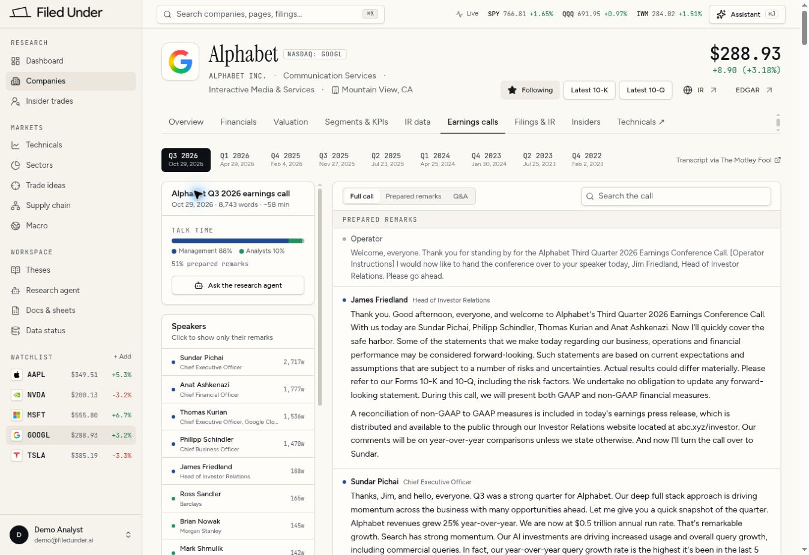

# Filed Under — reference visual system

## Direction and evidence

User-selected reference: https://company-showcase-launchpad.lovable.app/app/companies/GOOGL/calls?section=all

Inspected on November 4, 2026 through the site's public demo workspace at a 1348 × 936 desktop viewport. Firecrawl extracted branding from the sign-in page; the application itself was then inspected visually and through computed DOM styles. Application values below take precedence over sign-in branding. The screenshot is a visual reference, not a source for financial data.

The defining details are warm paper surfaces, dark ink, a serif company title, compact Figtree controls, JetBrains Mono metadata, small precise borders, and a restrained paper shadow. The existing application should adopt these details consistently without changing data providers, evidence records, calculations, or editor history.

## Extracted tokens

These values are taken from the rendered application's CSS.

| Role | Value |
|---|---|
| Page background | `oklch(98.2% .007 85)` |
| Card surface | `oklch(99.3% .004 85)` |
| Sidebar surface | `oklch(96.6% .009 85)` |
| Main ink | `oklch(19% .012 260)` |
| Muted ink | `oklch(47% .014 260)` |
| Divider | `oklch(88.5% .012 85)` |
| Input border | `oklch(86% .012 85)` |
| Secondary surface | `oklch(94.5% .01 85)` |
| Sidebar selection | `oklch(93% .012 85)` |
| Primary action | `oklch(20% .012 260)` |
| Selected period tab | `oklch(17% .012 260)` with `oklch(96% .008 85)` text |
| UI font | Figtree, system sans-serif fallback |
| Display font | Instrument Serif, Georgia fallback |
| Metadata/numerals | JetBrains Mono, system monospace fallback |
| Company title | 38.4px / 38.4px, weight 400 |
| Section headings | 14px / 20px, weight 600 |
| Search | 32px high, 14px text, max width 384px |
| Small actions | 32px high, 12px text, weight 500 |
| Control radius | 6px |
| Paper shadow | `0 1px 0 oklch(20% .01 260 / .04), 0 1px 2px oklch(20% .01 260 / .06)` |
| Sidebar | 240px wide; brand row 48px high |
| Top bar | 48px high; 24px horizontal padding |
| Main gutter | 32px desktop, 24px top |

Nav group labels are small uppercase monospace with generous letter spacing. Navigation is grouped into Research, Markets and Workspace. Company logos use a bordered square tile. Company name and ticker badge share one line; legal name/sector/location are subordinate. Quote and filing actions sit opposite the company identity. Company tabs use a thin dark underline, with minimal vertical space between the tab strip and content.

The reference's yellow highlight is reserved for evidence emphasis. Its application primary buttons are dark ink; the sign-in page's yellow demo button is not the application primary-action token.

## Implementation choices

1. Adapt current HTML/CSS/JavaScript and its existing routes. Replacing the app with React/shadcn would add migration risk without being necessary for this visual change.
2. Update the shared tokens and shell in `professional.css`, `index.html`, and the shell functions in `app.js`. Use actual stored index quotes in the compact header tape and retain an explicit price-as-of label. Do not claim live prices.
3. Add scoped company classes in `pCompany()` and a dedicated company stylesheet. Preserve all existing metric/source actions, tabs and company details. A collapsible company-details area can hold the long registrant metadata; the default identity/header should follow the reference's compact composition.
4. Adapt analyst pages and workspace chrome to the same surfaces/fonts. Keep document content typography, white paper, spreadsheet data, formula behavior, evidence links, assistant proposal review, and undo/redo intact.
5. Keep the current source-linked morning-brief table and apply the new visual system. Preserve disclosures and missing-data states.
6. Keep navigation and tables usable at narrow widths. Use the existing 860px navigation breakpoint; do not pretend desktop-only reference inspection establishes the reference's mobile behavior.

## Scope and constraints

- This is a visual and layout refinement. A new earnings-call reader is not required to match the reference's style; the reference's sample transcripts, prices, and other figures must not be copied into application data.
- No model calls, emails, provider configuration changes, or database migrations.
- Preserve existing page IDs/hash routes, keyboard shortcuts, watchlist state, source hooks, editor state, and numerical formatting semantics.
- Scope display-font rules to app page titles. Never apply the serif title treatment to user-authored document headings or embedded source documents.
- Define `--topbar-height: 48px` once and consume it in the workspace viewport calculation.
- Existing logo artwork remains; the wordmark sizing and weight should follow the reference.

## Verification

Review company, morning brief, research assistant, source drawer, and document/spreadsheet views. Existing accuracy and editor suites must remain green. Add targeted interaction tests for changed shell/company behavior rather than tests that assert CSS strings. Build the production bundle and inspect the deployed result. Record any viewport or provider-access limits honestly.
