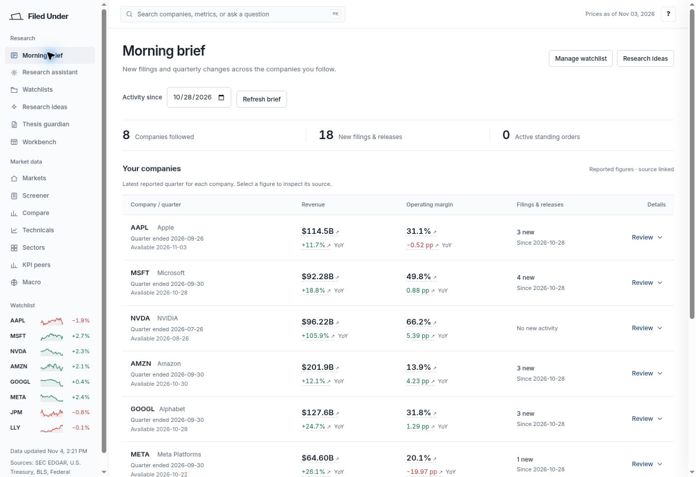
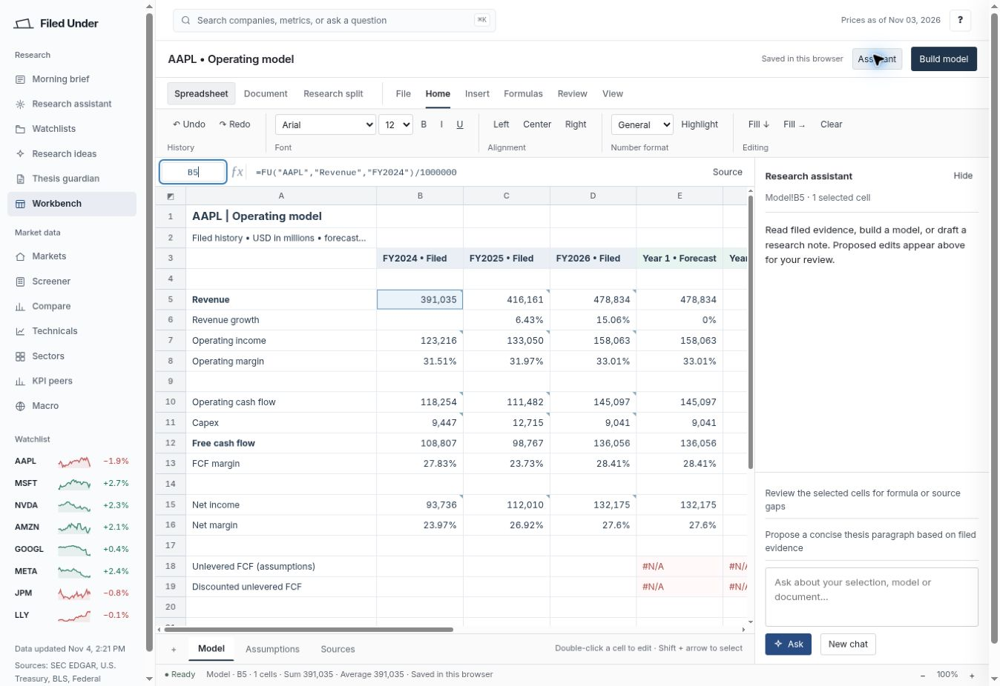
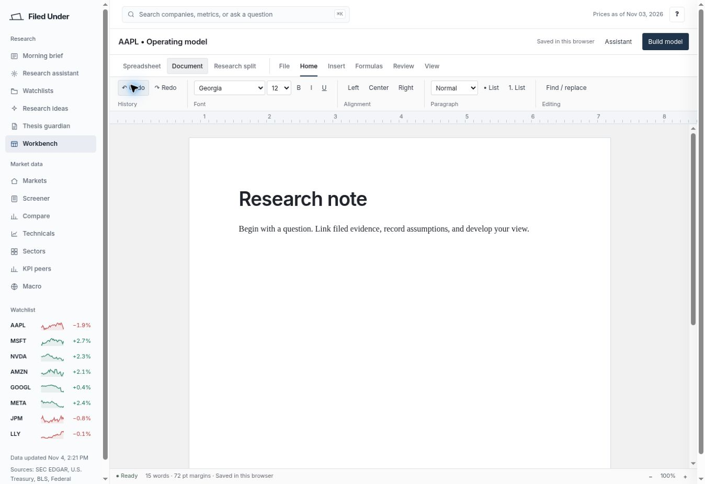

# Interface refinement: production verification

Verified on 2026-11-04 against production commit `bad3e4e0c318a3b6e88021855fe764efbafbc850`.

## Shipped changes

- [PR #6](https://github.com/nevaubi/filedunderai/pull/6): neutral shared shell, grouped navigation, compact editor ribbon, assistant visibility/focus behavior, flatter research sections, and a source-linked morning-brief comparison table. Includes the [API requirements guide](../../api-requirements.md).
- [PR #7](https://github.com/nevaubi/filedunderai/pull/7): remove the browser's default body margin so the editor status bar fits the viewport; prevent native formatting input events from adding a duplicate document undo entry.
- [Final CI run](https://github.com/nevaubi/filedunderai/actions/runs/41909198094): completed successfully on the production commit. Its required steps run JavaScript tests, financial tests, technical parity checks, and the production build.
- [Production deployment](https://vercel.com/me-3054/filedunderai/DvVeNKjmdKPpqnGRsKF4t7dhCRt3): Vercel reported success for the same commit.

## Live checks

Chrome cloud-browser viewport: 1348 × 936 CSS pixels. Screenshots below were captured from the deployed application after the final fixes.

| Check | Observed result |
|---|---|
| Page frame | Body starts at x=0, is 1348 pixels wide, and ends at y=936. The editor status bar ends at y=936. |
| Spreadsheet edit and undo | Entering `=1+2` into an unused cell displayed `3`; Undo restored the empty cell. |
| Spreadsheet source | Selecting model cell B5 displayed `=FU("AAPL","Revenue","FY2024")/1000000`; source inspection opened the corresponding filed-revenue evidence record. |
| Assistant panel | The header toggle showed and hid the research assistant. Automated coverage checks that Review proposal reveals and focuses it. |
| Document formatting | Selecting “Research” and choosing 18 pt applied an explicit font-size span. After the input debounce interval, one Undo restored the original heading. |
| Document history regression | Automated regression coverage verifies formatting undo/redo and ordinary typing history; the production browser confirmed the one-step formatting undo. |
| Brief summary and disclosure | Company rows retained the reported period, availability date, revenue, margin and activity window. Review/Close expanded and collapsed the full quarterly comparison. |
| Brief evidence | Selecting the AAPL quarterly revenue opened its derived-quarter evidence record, including cumulative-minus-YTD provenance. |
| Missing metrics | Unavailable operating-margin values were shown as dashes rather than fabricated zeroes. |

The formula, source, assistant and disclosure checks were performed on the UI deployment from PR #6. The final deployment was then checked for the page-frame and document-history fixes and used for all three screenshots. The final code passed the complete CI workflow.

## Screens

### Morning brief

[Open the live morning brief](https://filedunderai.vercel.app/#analyst).

### Spreadsheet

[Open the live workbench](https://filedunderai.vercel.app/#workbench), then choose Spreadsheet. The screenshot shows an existing local demonstration workbook with filed history and explicitly labeled forecast assumptions.

### Document

Choose Document in the workbench. The screenshot uses the default research-note document; test formatting was undone.

## Scope and remaining limits

- This work did not activate API access, change provider credentials, make billable model calls, or send alert emails. Provider IDs and account readiness remain unverified; see the API guide for the code's actual dependencies.
- The editors are custom browser editors with Office-like controls. This release does not establish full Microsoft Word or Excel feature or file-format parity.
- Phone-size visual QA was not available in this browser environment. Responsive layout rules were reviewed and relevant DOM behavior is covered, but that is not a substitute for a real narrow-viewport check.
- During a source-inspection check, the long-lived browser session reported that its evidence ledger could not be saved to browser storage and was available for that session only. The source and value still rendered. Cross-session evidence durability was therefore not established by this check; no browser data was cleared to conceal the limitation.
- These checks validate UI behavior and source wiring, not every financial fact in the datasets or a complete end-to-end AI answer with active provider access.

The screenshots and this report are verification artifacts; they do not alter the application runtime.
