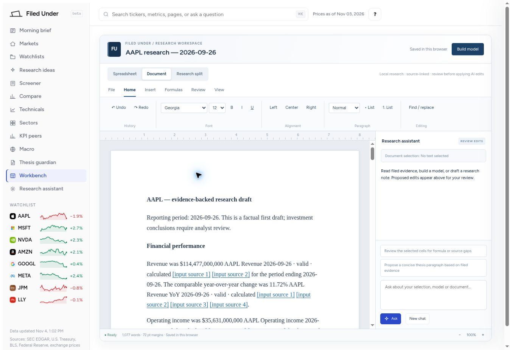
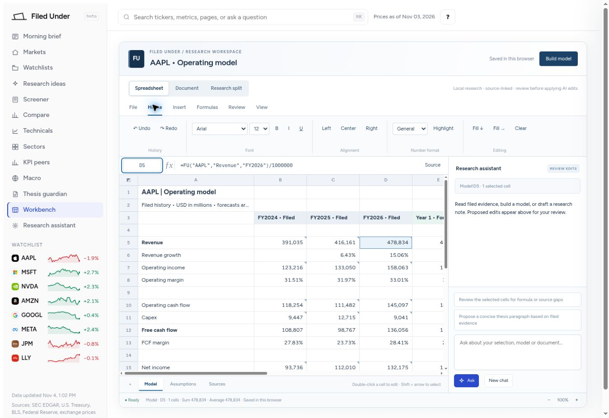

# Production verification — November 4, 2026

## Release

- Production: https://filedunderai.vercel.app/
- Core implementation: [PR #1](https://github.com/nevaubi/filedunderai/pull/1).
- Evidence, monitoring, thesis and editor follow-up: [PR #2](https://github.com/nevaubi/filedunderai/pull/2), merge 037552654fd5c85193d725b34e07614f5742788d.
- Column-width correction: [PR #3](https://github.com/nevaubi/filedunderai/pull/3), merge f177ce16e27790b480d861410d9ab62ffba901d2.
- The worksheet-layout production deployment reported success at 19:29:55 UTC. [Main CI](https://github.com/nevaubi/filedunderai/actions/runs/41897279302) passed.

## Automated checks

105 JavaScript tests passed with no failures. The financial suite passed 28 tests, all 1,698 technical parity events matched, and the build emitted 22 content-fingerprinted assets. Five offline AMT publisher fault tests passed, including reviewed-input drift refusal, unrelated-company preservation and restoration after injected failure.

Three additional statement-renderer regressions cover the observed AMT EPS scaling error, monetary/share scale inference, foreign/arbitrary units, custom-concept boundaries and immutable preservation of raw source-unit provenance. Exact known per-share concepts now render 1.86 and 3.71 without a thousands divisor; source details explain the unit decision.

The final independent review identified an accepted-null cell value that could not survive reload. It was fixed with apply/save/reload, legacy recovery and undo-provenance coverage. No further blocker was identified within that bounded review; this does not certify untested provider-dependent paths.

## Browser and export checks

- Formula entry and undo work; document and spreadsheet views render with the assistant composer, sheet tabs and status area visible.
- Morning brief loads followed companies and source events; reported changes link to evidence, including recursively calculated quarter values.
- Generated reports retain all original input filing links. The actual downloaded DOCX contains 41 distinct evidence IDs, four original filing URLs, formulas and input registers. Percentage-point changes are labeled correctly, and raw citation tokens are absent.
- Actual XLSX download contains five worksheets, twelve defined names and sixty-five formulas.
- The thesis assistant opens with explicit proposal review and market-share coverage guidance; no live model request was sent.
- Plain-English card-loss standing order previews its exact dollar net-charge-off metric and requires activation. No rule, cloud preference or email subscription was activated during the checks.
- Live worksheet measurement after the final fix: A is 260 px; B–E are 118 px. The previous 556.25 px expansion caused by long cell text is resolved.

## Screenshots

These are public-data examples from the deployed application, with no signed-in account or private user content.

## Boundaries

The editors are custom Office-style components, not full Microsoft Word/Excel parity. DOCX import, complete Excel function coverage, coauthoring and native Word pagination/track changes are not implemented. The exports were inspected as real Office packages; opening them inside installed Microsoft Office was not tested.

Provider sign-in, paid model completion and email delivery were not exercised. Monitoring logic and role boundaries have automated coverage; email needs provider/sender configuration and verified opt-in. A provider-accepted email is not labeled delivered.

Historical studies require source-vintage and price coverage and exclude unverifiable legacy observations. Current-universe and dividend exclusions remain explicit. Legacy financial datasets enter the normal bounded normalization rotation; they have not all been individually reconciled. Valuation fields without sourced share-count metadata remain unavailable until refreshed.

## AMT data correction

The guarded AMT-only repair completed with `status: verified` under run `20261104T193211Z-46fe67eead`. Eight private backup objects passed byte-for-byte read-back checks before financial writes. The five public artifacts and database mirror passed final verification; the reviewed fact population is now 2,911 rows, after removing 30 unsupported observations.

Independent SQL at 19:39 UTC confirmed the following published values. Prices retain the November 3 snapshot.

| Observation | Published result |
|---|---:|
| Q3 revenue, July 1–September 30, 2026 | $2,785,400,000 |
| Trailing revenue | $11,009,500,000 |
| Q3 operating margin | 45.558986% |
| Trailing net margin | 30.733457% |
| Price/sales | 7.889393× |
| Trailing EPS / P/E | Unavailable |
| Sourced shares, October 20, 2026 | 463,763,555 |
| Remaining derived quarterly EPS/share facts | 0 |
| Active financial publication leases after completion | 0 |

The [original filing](https://americantower.gcs-web.com/node/29311/html) reports consolidated revenue of $2,785.4 million; the old series had selected the $202.5 million contract-revenue component. The exact source context and candidate were reviewed before publication. See the [financial task report](../../superpowers/plans/task-financials-report.md) and [execution ledger](../../superpowers/plans/2026-11-04-progress.md) for the guarded preflight, baseline refresh and rollout limits.

The sanitized [AMT verification record](amt-repair-verification.json) includes the successful publisher receipt, independent public hash matches, database observations and live source-details check. Non-AMT index/screener preservation was independently checked for 499 rows each. The older fundamentals snapshot is not an independent apply-time baseline; that comparison limit is explicit in the record.
