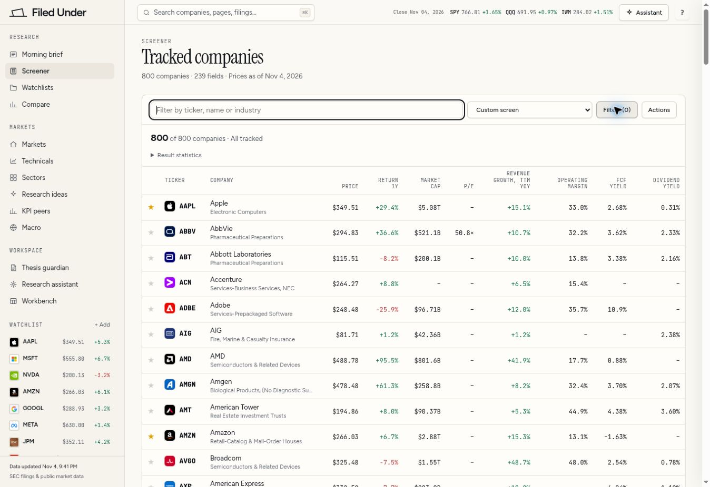

# Additional 300 companies: publication and activation evidence

## Release status and scope

The 300-company financial, price and investor-relations publications are complete on the existing Supabase project `apxfeteebnspwyajlxfh`. Coverage now contains 800 entries. Production code is deployed on the existing Vercel project `filedunderai`, and direct browser verification has passed. Aggregate activation, browser verification and the final audit archive have all completed. The completion table records their exact receipts and times.

The approved cohort is `additional-300-mdy-2026-11-03-r1`, manifest SHA-256 `610ea67ae73465dfc064f7a9022ebcc3d3afe3f05399c0a4e46cd127c2dc6b65`. Its 300 tickers and CIKs are unique and disjoint from the original 500. Official MDY holdings dated 2026-11-03 establish selection order; SEC and exchange records establish issuer identity. Fund holdings are not an independent index-membership certification. TREX replaces OZK because OZK's official SEC Company Facts endpoint returned 404; the original cohort and exclusion evidence remain preserved.

The public universe expands from 500 to 800. The original S&P 500 membership remains 500, and the exact legacy S&P 100-labelled set remains **102 tickers**. All tracked, S&P 500 and S&P 100 filters use explicit membership, including saved legacy S&P 500 screen specifications.

## Completed publications

| Publication | Verified result | Evidence |
| --- | --- | --- |
| SEC financial data | 300 companies; 652,811 fact rows; 74,339 filing rows; 900 SEC document records | `publication-final-report.json` |
| Financial value reconciliation | All 300 per-company fingerprints match all stored fact fields; zero mismatches | `fact-fingerprints.verification.json` |
| Core relational census | Issuer CIKs, per-company filing counts and all three SEC document categories match | `publication-relational-counts.verification.json` |
| Prices | 300 companies; 708,210 daily bars; 600 source objects verified; publication and relational readbacks complete | `prices/publication-report.json` |
| IR library | 300 companies; 307 documents; all immutable metadata and global document owners reconciled | `ir-stream-report.json`, `ir-relational-verification.json` |
| IR coverage | Exactly 800 entries; original 500 entries and KPI/segment count timestamps preserved | `coverage-publication-report.json` |

Core publication completed at **2026-11-05 03:00:34 UTC**, price publication at **03:23:44.090581 UTC**, and coverage publication at **03:25:58 UTC**.

### Financial sources and preserved records

All 600 original SEC submissions and Company Facts response bodies were archived before normalization. Every promoted financial point is checked against the exact issuer, concept, unit, period, accession and original record. Derived points require recursively resolved source inputs and verified arithmetic. The independent database reconciliation covers all 13 stored fact fields, with exact numeric normalization, explicit null markers, length-framed values and sorted SHA-256 fingerprints. Core publication verified 1,500 source, proof and company objects.

The source-quality review quarantined 168 candidate occurrences across eight companies: 30 with period ends after filing dates and 138 with unsupported quarterly durations. Original records and reasons remain archived. CAVA's documented 16-week first quarter is supported; the longer VAL transition and SCI anomaly remain excluded. Filing tables are reconstructed only from verified source records.

The 243 shared filing references retain their existing owners. The secondary issuer keeps its archived reference; exact metadata and absence from financial proofs are required before accepting a shared ownership or Form 425 reference. No existing filing owner was reassigned.

### Prices, IR and unavailable metrics

Price sources include 7,335 dividend events and 47 splits. Yahoo Finance attribution is separate from SEC financial provenance. The latest complete bar is 2026-11-03 for 299 companies and 2026-11-04 for CNO. Null historical closes remain missing. Comparison charts identify each series as total return or price return according to the available data.

Tavily and Firecrawl supported discovery and retrieval; provider output, issuer links and original files are archived. The 307 qualifying releases comprise 279 HTML documents and 28 PDFs, totalling 181,018,697 bytes. Independent reconciliation matched all 16 immutable metadata fields, 307 global document owners and 307 unique issuer/hash pairs. Publication dates are source-supported for 177 documents and explicitly absent for 130. The UBSI HTTP link uses its archived successful same-host/path HTTPS upgrade, preserving the requested URL and exact original body hash. ENS recovery after an interrupted checkpoint required matching document identity and readback of both original and extracted text bytes.

IR coverage remains **partial**: checked recent releases are available, while exhaustive historical enumeration is incomplete. No numeric operating KPIs were promoted from IR documents in this batch. Coverage retains 3,944,368 existing KPI values, the KPI-count timestamp `2026-11-05T00:07:30.948382Z` and the segment-count timestamp `2026-11-04T09:16:53Z`. New-company news and insider-window metrics remain unavailable until their collection windows are established.

## Deployment and aggregate cutover

[PR 14](https://github.com/nevaubi/filedunderai/pull/14) introduced membership and publication support. [PR 15](https://github.com/nevaubi/filedunderai/pull/15) merged the activation release as production commit `0166ef66f323bd451fd102636b75ec6f5858d88e`. Deployment `dpl_GucXyizgRrf9dbZdBkovuV1d3mi6` reached production READY at **2026-11-05T03:22:39.624Z**. Its approved source commit is `2a1e51a46edb8ddb34f11787c72dc4de31c52b5e`; the release plan and deployment marker bind the Git tree, registry hash and existing Supabase project.

The active registry was deployed while the price publisher held the shared aggregate lease. Production reached READY at **03:22:39.624 UTC**, before price publication completed at **03:23:44.090581 UTC** and coverage completed at **03:25:58 UTC**. The public aggregate cutover began only after all per-company receipts and coverage were complete. Deployment was already READY when the activation operator acquired, and later reacquired, the lease. A fresh run-bound marker identifies that deployment, and the 305-second drain expired at **03:27:44.624 UTC**, before retry run `0571f493-d129-4602-a0d4-23eadb0df1b4` began at **03:31:54.637785 UTC**. The release uses successive holders of the shared lease; one activation lease did not span the earlier deployment.

The first activation attempt stopped **before any public aggregate write** because an exact-800 fundamentals-cache assumption rejected preserved legacy `BK` metadata. The original cache contains 501 entries. Baseline and observed snapshots establish that `BK` is unchanged; it remains outside the public 800-company universe. The corrected guard permits only baseline-bound, unchanged legacy extras and still requires the exact public company set. Attempt 1 and its deployment marker are retained as evidence.

Recovery cache verification passed at **04:10:06 UTC**: all **300 new funds** match their verified staged inputs, and **498 original-company fund entries** remain unchanged. Across **72 stable financial fields**, all **497 companies with unchanged calculation inputs** match their prior values. The three recorded exceptions are ABT and BLK, whose newer filing inputs are source-validated, and KVUE, whose prior screener price was null despite a saved complete close of **$19.31 on 2026-10-30**. The rebuild restores that saved KVUE quote and seven dependent fields (`mcap`, `ev`, `ev_ebit`, `ev_sales`, `pb`, `ps` and `altman_z`). **Existing index quote changes: zero.** Original coverage entries and legacy BK metadata remain preserved. All 800 source readbacks, the 300 new proof-file comparisons and feed publication subsequently passed and are recorded in the final activation receipt.

### Interrupted retry and tail recovery

The retry's original execution runner was interrupted around **03:57 UTC** by the execution service error **“network approval was cancelled before a decision was returned”**. The stored screener run (`223`) independently records `status=ok`, **800 rows** and completion at **03:57:05 UTC**; all **800 screener source files** had been published. Feed publication and the complete final verification gates had not yet finished, so the original operator did not produce a successful activation receipt.

A read-only request to the same Supabase project passed at **03:59:14 UTC**. The interrupted report, deployment marker and explicit interruption record are preserved as `activation-report-interrupted.json`, `activation-deployment-ready-interrupted.json` and `activation-interruption.json`. The original activation helper remains unchanged at SHA-256 `c0e097f722c5ee80df85301f299c8fe6f40f9e548a7edaa3cff5f1e8a4d33ed0`.

The recovery helper is limited to finishing the feed and repeating every original final verification gate. It preserves the published index, screener and source bundles, acquires the normal aggregate lease after expiry without forcing a release, and binds a fresh recovery UUID and deployment attestation to the same logical run `0571f493-d129-4602-a0d4-23eadb0df1b4`. The final receipt retains the original checkpoint/helper links and separately records the recovery helper, marker and checkpoint hashes. Recovery UUID: `7bb436b4-14ed-4b7d-8934-185003160b4f`; all original gates passed, with completion recorded in the activation receipt below.

## Production browser verification

Production browser verification is complete at **2026-11-05T04:04:25.093425+00:00**, following the initial checks at **2026-11-05T03:54:49.202461+00:00** and a post-publication screener-source check. The verified receipt `browser-verification.json` is bound to deployment `dpl_GucXyizgRrf9dbZdBkovuV1d3mi6` and activation run `0571f493-d129-4602-a0d4-23eadb0df1b4`, with no failures.

| Check | Observed result |
| --- | --- |
| Membership filters | All tracked: **800**; S&P 500: **500**; legacy S&P 100: **102**. |
| New-company screener search | `OKTA` returns one Okta row; price **$189.68**, close dated **2026-11-03**; missing fields display `–`. The final screener state is All tracked, empty search and no filters. |
| Financial value and original source | OKTA FY2026 revenue displays **$2,919 million**, matching reported **USD 2,919,000,000**, period **2025-02-01 through 2026-01-31**, accession `0001660134-26-000020`, filed **2026-03-05**. The viewer highlights `us-gaap:RevenueFromContractWithCustomerExcludingAssessedTax`, and the [original SEC filing](https://www.sec.gov/Archives/edgar/data/1660134/000166013426000020/okta-20260131.htm) renders. |
| Published screener source and arithmetic | OKTA `rev_g_ttm` displays **+11.2%**. Its source drawer loads eight filed quarterly inputs in USD millions: **[805, 765, 761, 742]** versus **[728, 688, 682, 665]**. The displayed growth matches **3,073 / 2,763 − 1 = 11.2197%**; the latest quarter ends **2026-07-31**. The four recorded accessions are `0001660134-26-000069`, `0001660134-26-000051`, `0001660134-26-000020` and `0001660134-25-000171`. All tracked 800 was restored afterward. |
| IR original and coverage labels | The [Okta Q2 FY2027 release](https://www.sec.gov/Archives/edgar/data/1660134/000166013426000068/okta-7312026_ex991.htm), published **2026-08-26**, renders from its stored original; the library shows **Text verified** and **Backfill incomplete**. |
| Comparison return labels | The chart heading is **Returns, rebased to 100**; OKTA is labelled **OKTA · Price return**. AAPL, MSFT, NVDA, GOOGL and SPY retain total-return series; the distinction is explained visibly. The original four-company selection was restored after the check. |

Screenshot: `docs/verification/filedunder-800.jpg`, SHA-256 `5f025928734f0a6247db0222687f392c6e7e8bf2c8ebae5e8de89ff10cf79038` (127,652 bytes).

## Completion receipts

All three completion gates have successful receipts. The final audit archive includes 39 evidence files and its manifest, with 40 exact byte/hash readbacks.

| Gate | Status | Final evidence |
| --- | --- | --- |
| Aggregate activation | **Published and verified** | `activation-report.json` reports `status=published`, `phase=verified`, 800 companies, exact index/screener sets, 500/102 memberships, all 800 source readbacks and preservation checks, plus the recovery checkpoint/marker/helper bindings; completion time: `2026-11-05T04:16:49Z`. |
| Browser verification | **Verified** | `browser-verification.json`, verified **2026-11-05T04:04:25.093425+00:00**, bound to the deployment and run above; includes the post-publication source-drawer check. |
| Final audit archive | **Published and verified** | `final-audit-publication-receipt.json` reports `status=published`; completion time: `2026-11-05T04:21:46.486344+00:00`; manifest: `backfills/additional-300-mdy-2026-11-03-r1/final-audit/manifests/2c1e95980b714dbc801864211953ba7ce3447401eaa7a3c848ce983ab5fd3027.json`; SHA-256: `2c1e95980b714dbc801864211953ba7ce3447401eaa7a3c848ce983ab5fd3027`. |

## Durable evidence and release checks

Evidence is retained in the existing private Supabase `raw` bucket, with batch records under `backfills/additional-300-mdy-2026-11-03-r1/`. Exact SEC source snapshots and price originals are separate hash-verified storage objects. Research material is additionally retained in three verified archive shards with a file manifest; those shards are not the complete container for all SEC and price originals. The final audit publication archives content-addressed reports, SQL and fingerprint evidence, redirect reconciliation, coverage and activation records, the first failed gate, interrupted retry and tail-recovery evidence, the legacy-fundamentals proof, browser evidence and reviewed operator helpers. Its manifest is published only after every included object passes exact byte and SHA-256 readback.

[CI run 41961031825](https://github.com/nevaubi/filedunderai/actions/runs/41961031825) succeeded with 193 Python financial/source tests, 186 JavaScript tests and 1,698 parity cases. The production build contains 27 assets. Final release completion is recorded by the three completion receipts above; historical IR enumeration and uncollected activity metrics remain explicit limitations.
